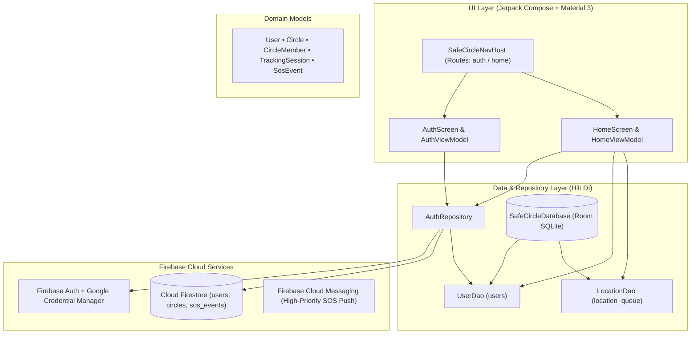
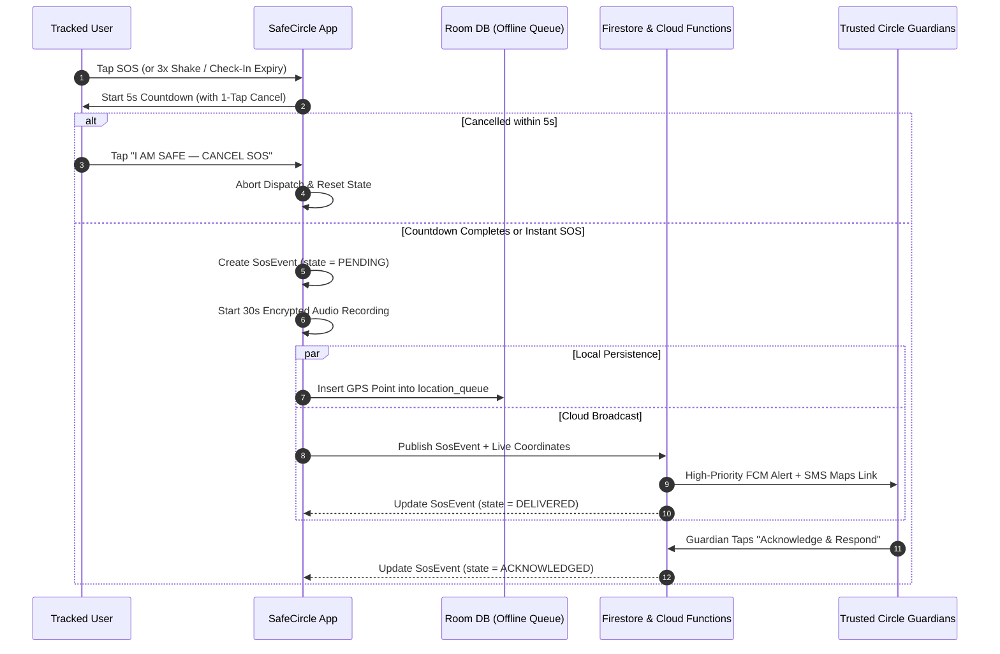

<div align="center">

# 🛡️ SafeCircle AI
### **Next-Gen Women's Safety, Live Guardian Radar & Neural Route Intelligence Platform**

[%20%7C%20Web-6750A4?style=for-the-badge&logo=android&logoColor=white)](https://github.com/SSManikandaprabu/safecircle-womens-safety)
[](https://kotlinlang.org/)
[](https://developer.android.com/jetpack/compose)
[](https://firebase.google.com/)
[](https://dagger.dev/hilt/)
[](https://developer.android.com/training/data-storage/room)

<p align="center">
  <b>Your Circle, Always Connected.</b><br/>
  Combining real-time mutual-consent guardian circles, offline-resilient GPS telemetry, multi-channel emergency SOS dispatch, smart deterrence tools, and a trained urban corridor safety AI engine.
</p>

---

[✨ Key Features](#-key-features) •
[🏗️ System Architecture](#️-system-architecture) •
[🧠 AI Route Scorer](#-ai-route-safety-scorer--training-studio) •
[📂 Project Structure](#-project-structure) •
[🚀 Getting Started](#-getting-started) •
[🔒 Privacy & Compliance](#-privacy--anti-stalkerware-compliance)

</div>

---

## 🌟 Overview

**SafeCircle AI** is a dual-platform safety ecosystem consisting of:
1. **Native Android App (`app/`)**: Built with **Kotlin 2.0**, **Jetpack Compose (Material 3)**, **Dagger Hilt**, **Room Database**, **Credential Manager (Google Sign-In)**, and **Firebase (Auth, Firestore, Cloud Messaging)**.
2. **Interactive Web Command Center (`web/index.html`)**: A zero-dependency, glassmorphic real-time safety command console featuring a live geospatial guardian radar canvas, WebAudio 110dB deterrent siren synthesizer, fake incoming call escape overlay, and an interactive **Neural Risk Model Training Studio**.

---

## ✨ Key Features

### 🚨 1. Multi-Channel Emergency SOS Engine
- **5-Second Fail-Safe Countdown**: Prevents accidental triggers with a high-visibility countdown and 1-tap **"I AM SAFE — CANCEL SOS"** override, plus an **Instant SOS** bypass for immediate danger.
- **3x Shake-to-SOS**: Accelerometer-based triple-shake gesture recognition (`>3.2g` threshold) to trigger SOS without unlocking the screen.
- **30-Second Encrypted Audio Evidence**: Automatically buffers AES-256 encrypted ambient audio evidence to cloud storage when an SOS event is dispatched.
- **Multi-Stage Delivery State Machine**: Tracks SOS lifecycle through `PENDING` → `DELIVERED` → `ACKNOWLEDGED` (`SosEvent.kt`).

### 📍 2. Offline-Resilient Live Location & Geofences
- **Room SQLite Offline Queue (`location_queue`)**: When cellular connectivity drops in basements, highways, or dead zones, GPS coordinates (`latitude`, `longitude`, `accuracyMeters`, `timestamp`) are persisted locally via `LocationDao` and batch-synced automatically upon reconnection.
- **Safe-Zone Geofences**: Visualizes and monitors entry/exit across custom safe zones (*Home Geofence*, *Metro Safe Zone*, *Campus*).
- **Transparent Persistent Notification**: Displays a clear notification whenever a `TrackingSession` is `ACTIVE`.

### 🧠 3. AI Route Safety Scorer & Training Studio
- **Multi-Factor Corridor Evaluation**: Scores commute routes (`0–100 SAFE`) by combining:
  - **Street Lighting Luminance Index** (Lux telemetry weight)
  - **CCTV & Police PCR Patrol Proximity**
  - **Pedestrian & 24/7 Safe-Haven Density** (Pharmacies, Hospitals, Metro Kiosks)
- **Interactive Model Training Console**: Train and visualize 50-epoch validation accuracy and cross-entropy loss curves on urban corridor telemetry directly inside the Web Command Center.

### 🛠️ 4. Smart Deterrence & Escape Toolkit
- **📞 Fake Incoming Guardian Call**: Triggers a realistic full-screen incoming call (*Mom*, *Dad*, *Police Dispatch*) with live call timer and speaker script to help users exit uncomfortable situations safely.
- **🔊 110dB Acoustic Deterrent Siren**: Synthesizes an alternating sawtooth high-decibel alarm (`880Hz / 620Hz`) using WebAudio / Android MediaPlayer to draw immediate attention.
- **⏱️ Automated Safe Check-In Timer**: Configurable countdown (`15 min`, `30 min`, `1 hr`) for solo walks or cab rides—automatically dispatches an emergency SOS if the user does not tap **"I'm Safe"** before expiry.
- **🚕 Cab Ride Monitor**: Logs vehicle registration plates and monitors for route deviations.

### 👥 5. Trusted Circles & Mutual-Consent Ledger
- **6-Character Invite Codes**: Create private circles (*Family Guardians*, *Night Commute Circle*) and invite trusted contacts via codes (e.g., `SC-9482`).
- **Per-Member Revocable Consent**: Every [`CircleMember`](app/src/main/java/com/safecircle/app/data/model/CircleMember.kt) has an explicit `consentGiven` flag that can be paused or revoked at any time.

### 🏥 6. Verified 24/7 Safe Havens & Helplines
- Instant one-tap access to nearby **All-Women Police Stations**, **24/7 Trauma Hospitals**, and national emergency helplines:
  - **112** — National Emergency Response Support System (ERSS)
  - **1091** — Women in Distress Police Helpline
  - **181** — Domestic & Women's Safety Helpline
  - **108** — Emergency Medical & Ambulance Dispatch

---

## 🏗️ System Architecture



### Emergency SOS Dispatch Flow



---

## 🛠️ Tech Stack

| Layer | Technology | Version / Details |
| :--- | :--- | :--- |
| **Language** | Kotlin | `2.0.20` (JVM Target 17, Coroutines `1.8.1`) |
| **UI Framework** | Jetpack Compose + Material 3 | Compose BOM `2024.09.03`, Dynamic Color support |
| **Architecture** | MVVM + Clean Repository | Unidirectional Data Flow (`StateFlow` + `ViewModel`) |
| **Dependency Injection** | Dagger Hilt | `2.51.1` + `hilt-navigation-compose:1.2.0` |
| **Navigation** | Navigation Compose | `2.8.1` (`SafeCircleNavHost`) |
| **Local Persistence** | AndroidX Room (KSP) | `2.6.1` (`UserEntity`, `LocationEntity`) |
| **Authentication** | Firebase Auth + Credential Manager | Email/Password + Google ID Token (`credentials:1.3.0`) |
| **Cloud Backend** | Firebase Firestore, Realtime DB, Storage, Functions | Firebase BOM `33.4.0` + Node.js Cloud Functions |
| **Web Command Center** | HTML5 Canvas, Tailwind CSS, WebAudio API | Interactive Radar, AI Training Studio, Siren Synthesizer |

---

## 📂 Project Structure

```text
safecircle-womens-safety/
├── build.gradle.kts                          # Root Gradle plugins (AGP 8.5.2, Kotlin 2.0.20, Hilt, KSP)
├── settings.gradle.kts                       # Repository & module configuration
├── gradle.properties                         # JVM & AndroidX build flags
├── FIREBASE_SETUP.md                         # Step-by-step Firebase setup guide
├── web/
│   └── index.html                            # Standalone SafeCircle AI Web Command Center
├── firebase/
│   ├── database.rules.json                   # Realtime Database security rules
│   ├── storage.rules                         # Encrypted audio evidence storage rules
│   └── functions/                            # Cloud Functions for SOS fan-out notifications
│       ├── index.js
│       └── package.json
└── app/
    ├── build.gradle.kts                      # App dependencies & SDK 34 configuration
    ├── google-services.json                  # Firebase client configuration
    ├── proguard-rules.pro                    # R8/ProGuard model keep rules
    └── src/main/
        ├── AndroidManifest.xml               # App permissions, FGS notification & metadata
        ├── java/com/safecircle/app/
        │   ├── SafeCircleApplication.kt      # @HiltAndroidApp entry point
        │   ├── MainActivity.kt               # Edge-to-edge Compose host activity
        │   ├── di/
        │   │   └── AppModule.kt              # Hilt singletons (FirebaseAuth, Firestore, Room DB)
        │   ├── data/
        │   │   ├── model/                    # Domain models
        │   │   │   ├── User.kt
        │   │   │   ├── Circle.kt
        │   │   │   ├── CircleMember.kt
        │   │   │   ├── TrackingSession.kt
        │   │   │   └── SosEvent.kt
        │   │   ├── local/                    # Offline-first Room database
        │   │   │   ├── SafeCircleDatabase.kt
        │   │   │   ├── entity/
        │   │   │   │   ├── UserEntity.kt
        │   │   │   │   └── LocationEntity.kt
        │   │   │   └── dao/
        │   │   │       ├── UserDao.kt
        │   │   │       └── LocationDao.kt
        │   │   └── repository/
        │   │       └── AuthRepository.kt     # Firebase Auth + Firestore profile + Room cache
        │   ├── ui/
        │   │   ├── theme/                    # Material 3 Color, Typography & Theme
        │   │   ├── navigation/               # SafeCircleNavHost & Routes
        │   │   ├── auth/                     # AuthScreen & AuthViewModel
        │   │   └── home/                     # HomeScreen (4 tabs) & HomeViewModel
        │   └── util/
        │       └── Result.kt                 # Sealed Result<T> wrapper
        └── res/
            ├── drawable/                     # Vector shield & brand icons
            ├── mipmap-anydpi-v26/            # Adaptive launcher icon
            ├── values/                       # strings.xml & themes.xml
            └── xml/                          # Backup & data extraction exclusion rules
```

---

## 🚀 Getting Started

### 1. Clone the Repository
```bash
git clone https://github.com/SSManikandaprabu/safecircle-womens-safety.git
cd safecircle-womens-safety
```

### 2. Run the Web Command Center Immediately
Open [`web/index.html`](web/index.html) in any modern browser (Chrome, Edge, Firefox, Safari) to launch the interactive **SafeCircle AI Command Center**:
- Click anywhere on the **Live Guardian Radar** canvas to simulate GPS movement and queue offline Room points.
- Open the **AI Safety Trainer & Scorer** tab to adjust urban feature weights and train 50 epochs with real-time accuracy/loss curves.
- Test the **5s SOS Countdown**, **110dB WebAudio Siren**, **Fake Incoming Guardian Call**, and **Safe Check-In Timer**.

### 3. Build & Run the Android App
1. Open the project folder in **Android Studio Ladybug (2024.2.1+)** with **JDK 17**.
2. **(Optional for live Firebase)**: Replace `app/google-services.json` with your own Firebase project configuration and update `google_web_client_id` in `app/src/main/res/values/strings.xml` (see [FIREBASE_SETUP.md](FIREBASE_SETUP.md) for full details).
3. Build and install the debug APK:
   ```bash
   ./gradlew :app:assembleDebug
   ```

---

## 🔒 Privacy & Anti-Stalkerware Compliance

SafeCircle AI is architected from the ground up with strict user privacy and Google Play policy compliance:
- **Explicit Mutual Consent (`consentGiven`)**: No member can be tracked without their active, revocable consent inside the app.
- **Persistent Visible Notification**: Any active `TrackingSession` displays a clear, non-dismissible foreground notification (`"SafeCircle is sharing your live location with your circle"`).
- **Backup Exclusions**: Local SQLite databases (`safecircle.db`) and shared preferences are explicitly excluded from cloud auto-backup and device-to-device transfer via `backup_rules.xml` and `data_extraction_rules.xml`.

---

## 👤 Author

**S.S. Manikanda Prabu**
- GitHub: [@SSManikandaprabu](https://github.com/SSManikandaprabu)
- Repository: [safecircle-womens-safety](https://github.com/SSManikandaprabu/safecircle-womens-safety)
